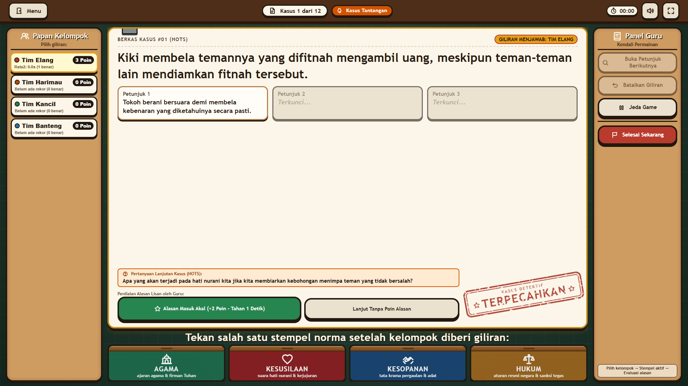
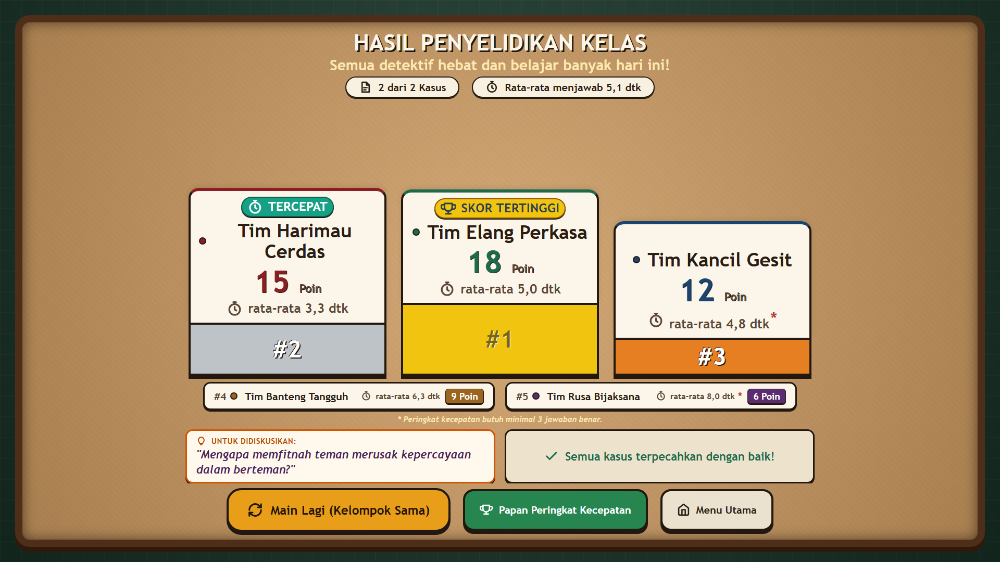

# Detektif Norma

Game edukasi interaktif materi **Norma dan Aturan Kehidupan Sehari-hari** untuk mata pelajaran **Pendidikan Pancasila dan Kewarganegaraan (PPKn) Kelas 5 Sekolah Dasar**.

Dikembangkan secara khusus untuk pembelajaran kolaboratif di kelas menggunakan **TV Interaktif / Layar Sentuh Kelas (PID)** maupun komputer desktop.

---

## 📸 Tangkapan Layar Game

| Papan Kasus Utama (Penyelidikan Kasus) | Layar Hasil Penyelidikan (Podium Juara & Rekor) |
| :---: | :---: |
|  |  |

---

## 🔍 Informasi Game
- **Pemilik Game:** Mas Dirga
- **Penyusun Materi:** Bu Fina, SD Negeri Sindangbarang 02
- **Arsitektur:** Vanilla HTML5, CSS3, JavaScript ES6+ (Murni tanpa Framework, tanpa Library, tanpa CDN, 100% Offline-Ready).
- **Target Tampilan:** TV Interaktif Kelas (PID / Layar Sentuh) & Monitor Desktop rasio 16:9 (1920×1080 dan 1366×768).
- **Audio:** Web Audio API mandiri (sintesis frekuensi audio tanpa file suara eksternal).
- **Standar Grafis & Aksesibilitas:** 100% Bebas Emoji (menggunakan 36 Sprite SVG Inline garis tebal 24px), tanpa maskot, tombol terlihat jelas pada kondisi normal tanpa hover, dan ramah `prefers-reduced-motion`.

---

## Cara Menjalankan Game
Game ini tidak membutuhkan instalasi software khusus, runtime Node.js, ataupun koneksi internet.

1. Buka folder proyek ini di komputer atau TV interaktif.
2. Klik dua kali berkas `index.html` untuk langsung membukanya di browser modern (Microsoft Edge, Google Chrome, Mozilla Firefox, atau Safari).
3. Untuk tampilan maksimal di TV kelas, tekan tombol **Layar Penuh** di pojok kanan atas layar awal atau papan kasus.

---

## Struktur Berkas
```text
Detektif Norma/
├── index.html        # Struktur antarmuka semantik, modal, & sprite 36 ikon SVG inline
├── style.css         # Sistem desain kantor detektif, variabel :root, layout responsif 16:9
├── game.js           # Alur kasus, sintesis audio Web Audio API, podium hasil, & peringkat
├── data.js           # Basis data 24 kasus (16 dasar + 8 HOTS) & validator mandiri
├── assets/           # Folder aset opsional (gambar & font lokal)
│   ├── bg-home.png   # (Opsional) Gambar latar belakang layar awal
│   ├── profil.png    # (Opsional) Foto profil pembuat
│   └── fonts/        # (Opsional) Berkas font lokal .ttf / .otf
├── README.md         # Petunjuk penggunaan, konfigurasi, dan modifikasi data
└── PROGRESS.md       # Catatan kemajuan pengerjaan per fase
```

---

## Sistem Ikon SVG Mandiri (Bebas Emoji)
Seluruh tombol, header, panel guru, modal, kartu stempel, dan pesan antarmuka menggunakan **Sprite SVG Inline** (`#svg-sprite`) yang dimuat langsung di `index.html`.
- **Standar Visual:** Grid 24×24px, garis tebal 2.5–3px, ujung membulat (`round`), warna terikat ke `currentColor` (mengikuti warna teks tombol secara otomatis).
- **Total Ikon (36 Simbol):** Kaca pembesar, berkas/dokumen, stopwatch, suara hidup/mati, layar penuh, menu/pintu, kelompok, buku panduan, piala, info, jeda, lanjutkan, batalkan, bendera selesai, bintang, lampu petunjuk, pensil/ubah, megafon, gembok, centang, panah kanan, serta empat ikon norma khusus:
  - `icon-norma-agama`: Tempat ibadah dengan kubah dan menara.
  - `icon-norma-kesusilaan`: Hati nurani dengan kilau kebajikan.
  - `icon-norma-kesopanan`: Dua tangan berjabat saling menghormati.
  - `icon-norma-hukum`: Timbangan keadilan seimbang.

---

## Aset Gambar dan Font (Opsional)
Aplikasi dibangun dengan prinsip **mandiri tanpa dependensi luar**. Jika folder `assets/` kosong, game tetap berfungsi normal dengan fallback SVG dan palet warna CSS.

### 1. Font Lokal
- **Letak folder:** `assets/fonts/`
- **Nama berkas yang didukung:**
  - `Nunito-Bold.ttf`
  - `Fredoka-Bold.ttf`
- **Fallback otomatis:** Bila berkas font tidak ditaruh, browser secara otomatis menggunakan font sistem bulat tebal (`ui-rounded`, `Nunito`, `"Trebuchet MS"`, `sans-serif`) yang ramah untuk anak-anak sekolah dasar.

### 2. Gambar Latar Layar Awal (Opsional)
- **Letak berkas:** `assets/bg-home.png`
- **Fallback otomatis:** Bila file tidak tersedia, sistem menggunakan warna latar hijau botol tua yang hangat (`#123624`) dengan tekstur meja detektif.

### 3. Foto Profil Pembuat
- **Letak berkas:** `assets/profil.png`
- **Ukuran yang disarankan:** `256×256 px` atau `512×512 px` (rasio 1:1 kotak/lingkaran).
- **Fallback otomatis:** Bila berkas `profil.png` belum diletakkan di folder `assets/`, modal Tentang otomatis menampilkan ilustrasi siluet detektif ramah berbasis vektor SVG bawaan.

### 4. Mengisi Kontak Pembuat
Untuk melengkapi informasi kontak resmi:
1. Buka berkas `index.html` dengan teks editor.
2. Cari teks `[ISI KONTAK]`.
3. Ganti teks tersebut dengan nomor WhatsApp, alamat surel, atau media sosial yang diinginkan.

---

## Alur Setup Kelompok & Pengingat Peran
1. **Pilihan Jumlah Kelompok:** Guru memilih jumlah kelompok (2, 3, 4, atau 5) dengan tombol angka besar.
2. **Kustomisasi Nama Kelompok:** Tepat di bawah tombol angka terdapat baris pratinjau nama kelompok aktif dengan tombol **Ubah**. Guru dapat mengganti nama kelompok sesuai nama regu di kelas, dan nama akan tersimpan ke penyimpanan lokal peramban.
3. **Pengingat Peran:** Ditampilkan **satu kali saja per sesi pembukaan halaman web** untuk memandu 4 peran detektif (Pembaca Kartu, Pengarah Tim, Pencatat, Penyaji Alasan) serta menegaskan aturan utama: *"Tidak boleh mengejek jawaban kelompok lain!"*.

---

## Layar Hasil Penyelidikan (Podium Juara & Lencana)
Setelah 12 kasus terselesaikan (atau saat guru menekan tombol *Selesai Sekarang*), game menampilkan panggung hasil:
1. **Podium Fisik 3 Besar:**
   - Juara 1: Balok emas di tengah dengan mahkota lencana prestasi.
   - Juara 2: Balok perak di kiri.
   - Juara 3: Balok perunggu di kanan.
   - *(Untuk sesi 2 kelompok, podium otomatis beralih menjadi 2 balok proporsional).*
2. **Kelompok Lain (Peringkat 4 & 5):** Tampil dalam baris horizontal yang rapi di bawah podium.
3. **Pemecah Skor Seri (Tie-breaking):**
   - Diurutkan berdasarkan perolehan skor tertinggi.
   - Jika skor sama, nomor peringkat tetap sama (misal sama-sama `#1`), dan posisi tengah podium diprioritaskan bagi tim dengan rata-rata waktu menjawab benar yang lebih cepat.
4. **Sistem Lencana:**
   - **Skor Tertinggi:** Dianugerahkan kepada kelompok peraih skor tertinggi (bisa lebih dari satu tim jika seri).
   - **Tercepat:** Dianugerahkan kepada kelompok dengan rata-rata waktu menjawab terendah, dengan syarat memiliki **minimal 3 jawaban benar**.
5. **Kasus yang Perlu Dibahas Bersama:** Bilah ringkas di bagian bawah yang merangkum maksimal 3 kasus yang belum terpecahkan untuk bahan refleksi guru di kelas.

---

## Menambah atau Mengubah Kasus di `data.js`
Seluruh data kasus tersimpan terpisah di dalam berkas `data.js` pada variabel `KASUS_POOL`.

### Aturan Komposisi Data Kasus:
- **Total pool:** Tepat **24 kasus** (16 kasus dasar + 8 kasus HOTS).
- **Keseimbangan per norma:**
  - **Agama:** 4 dasar + 2 HOTS
  - **Kesusilaan:** 4 dasar + 2 HOTS
  - **Kesopanan:** 4 dasar + 2 HOTS
  - **Hukum:** 4 dasar + 2 HOTS
- **Aturan isi:**
  - Satu kasus hanya memiliki **satu jawaban dominan yang tegas**.
  - Bahasa sederhana anak kelas 5 SD dengan panjang kalimat kasus maksimal sekitar 20 kata.
  - Menggunakan nama tokoh yang netral.
  - Petunjuk terdiri dari tepat 3 tingkat: Petunjuk 1 samar, Petunjuk 2 sedang, Petunjuk 3 hampir jelas (tidak menyebut nama norma langsung).
  - Kasus tingkat `"hots"` **wajib** mengisi bidang `pertanyaanLanjutan`. Kasus `"dasar"` wajib bernilai `null`.

### Contoh Skema Kasus:
```javascript
{
  id: "k01",
  tingkat: "dasar", // "dasar" atau "hots"
  kasus: "Dito selalu berdoa dengan khusyuk sebelum mulai menyantap makanan yang disajikan ibunya di meja makan.",
  jawabanId: "agama", // "agama" | "kesusilaan" | "kesopanan" | "hukum"
  petunjuk: [
    "Aturan ini bersumber dari keyakinan terhadap Tuhan Yang Maha Esa.",
    "Pelanggaran terhadap aturan ini mendatangkan rasa berdosa kepada Sang Pencipta.",
    "Perilaku ini merupakan bentuk syukur dan ibadah dalam kehidupan sehari-hari."
  ],
  pertanyaanLanjutan: null, // String pertanyaan pemandu jika tingkat "hots", atau null jika "dasar"
  alasan: "Berdoa sebelum makan adalah perintah ajaran agama sebagai wujud rasa syukur kepada Tuhan.",
  penjelasan: "Berdoa bersumber dari wahyu ajaran agama. Perilaku ini juga mendidik adab yang baik dalam bersantap."
}
```

Setiap kali `index.html` dimuat di browser, fungsi `validasiDataNorma()` secara otomatis memvalidasi keabsahan data, keunikan ID, jumlah petunjuk, serta keseimbangan norma. Informasi validasi ditampilkan pada Console peramban (F12).

---

## ⚡ Cara Kerja Papan Peringkat Kecepatan & Batasannya
Papan Peringkat Kecepatan dirancang untuk memotivasi diskusi kelompok yang sigap dan cermat.

1. **Metode Penilaian:**
   - Peringkat dihitung dari **rata-rata waktu berpikir kelompok pada jawaban benar** (makin kecil detiknya, makin tinggi peringkatnya).
   - Menghindari tebak asal: Jawaban salah **tidak dicatat** waktunya dan kelompok langsung terkunci untuk kasus tersebut.
   - Syarat masuk papan rekor: Kelompok harus menjawab **minimal 3 kasus dengan benar** dalam satu sesi permainan.
   - Peringkat 1 mendapat lencana istimewa **"Rekor Kelas"**.

2. **Batasan Penyimpanan Lokal (`localStorage`):**
   - Data rekor tersimpan secara lokal di browser perangkat tempat game dimainkan.
   - **Beda perangkat beda data:** Rekor yang tercatat di TV interaktif kelas tidak otomatis tersambung ke laptop guru (tanpa server/cloud).
   - Data akan terhapus jika riwayat / cache browser dibersihkan total.
   - Bila penyimpanan browser dinonaktifkan (misal mode Private ketat), game tetap bisa dimainkan tanpa kendala dan fitur rekor hanya berlaku sementara selama sesi aktif.

3. **Alat Cadangan Guru (Ekspor & Impor):**
   - **Ekspor Cadangan:** Klik tombol `💾 Ekspor Cadangan (.json)` di layar peringkat untuk menyimpan berkas `peringkat-detektif-norma.json` ke flashdisk atau komputer guru.
   - **Impor Cadangan:** Gunakan tombol `📂 Impor Cadangan` untuk memulihkan kembali data rekor kapan saja.
   - **Hapus Rekor:** Guru dapat mereset rekor kelas dengan **menahan tombol merah Hapus Rekor selama 2 detik** dilanjutkan dengan konfirmasi dialog.

---

## 🛡️ Hak Cipta & Kredit
- **Materi Soal & Kasus:** Bu Fina, SD Negeri Sindangbarang 02
- **Konsep & Pengembangan Aplikasi:** Mas Dirga
- **Kepatuhan Privasi:** 100% bebas login, tanpa pengumpulan data pribadi murid, aman untuk lingkungan sekolah.
